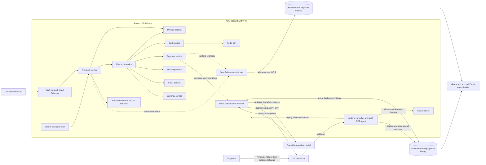

# Blame the Deploy: An AWS and Jenkins Interview Walkthrough

## The real-world problem

In a real online store, one small change can make a service unstable. For example, a developer might lower the memory limit of the payment service to save resources. The new version is deployed, the container runs out of memory, and checkout begins failing. The on-call engineer now has to answer several questions quickly: which service failed, when did it start, what changed just before the failure, who made that change, and how can the system be recovered?

Application logs can show an error, and Git history can show a code change, but they are often stored in different places. Connecting those two sources during an incident takes time and depends on the engineer already knowing where to look. This project demonstrates how deployment metadata and Kubernetes telemetry can be collected together so an AI assistant can help an engineer trace a failure back to a likely deployment.

## How I would introduce the project in an interview

“I built this project around a practical production-support problem: when a microservice starts failing after a deployment, how can an engineer identify the likely change without manually searching through separate logs and commit histories?

“The application is Online Boutique, a sample e-commerce website made up of small services. A customer browses products, adds items to a cart, and checks out. The services communicate with one another, so a failure in a service such as payments can affect the customer’s full checkout journey.

“I migrated the deployment path to Amazon EKS and Jenkins. When a change reaches the main branch, Jenkins authenticates to AWS through an EC2 instance profile, mirrors the versioned public sample images into Amazon ECR, renders the Kubernetes manifest with the ECR image references, deploys it to EKS, and waits for the service Deployments to become available. Jenkins then records the commit, author, changed service, and rollout result in Elasticsearch.

“The repository does not contain the microservice source code or Dockerfiles, so this pipeline does not claim to build the application. It copies the existing public sample images into ECR. In a full source-based CI pipeline, I would add the service source and Dockerfiles, run their tests, build images, and publish them to ECR before the deployment step.

“OpenTelemetry collects Kubernetes and application telemetry and sends it to Elasticsearch. Jenkins records each deployment attempt and its outcome. A read-only incident watcher continuously watches pod status changes, retrieves recent container logs and deployment records, and sends a bounded, redacted context to an OpenAI-compatible model for diagnosis. For a confident out-of-memory diagnosis, it can open a draft pull request that proposes a narrowly scoped memory adjustment. It cannot change or restart the live production pod. An engineer reviews the evidence and decides whether to merge the proposal.

“For a demonstration, I can deliberately give the payment service an insufficient memory limit. Kubernetes reports the container restarting or being killed for memory use. The telemetry is sent to Elasticsearch, the deployment event identifies the change that introduced the limit, and the assistant summarizes the likely cause and possible next checks. The assistant supports the engineer; it does not replace monitoring, incident response, or a human decision to roll back.”

## Architecture from commit to diagnosis

The customer-facing request reaches an internet-facing Network Load Balancer provisioned by the AWS Load Balancer Controller from the frontend Service annotations. The load balancer routes web traffic to the frontend service. The frontend and backend services then communicate over internal Kubernetes services, primarily using gRPC. The cart service uses Redis to hold cart contents, while checkout coordinates the product, cart, currency, payment, shipping, and email services.

The build and release path starts when a developer pushes a commit to the Git repository. A webhook starts Jenkins. In this checkout, Jenkins pulls the public demonstration images listed in `release/image-sources.txt`, tags each image with its source version and the commit SHA, and pushes it to Amazon ECR. The pipeline renders the image placeholders in the Kubernetes manifest, applies it to EKS, and waits for each Deployment to become available. The application source and Dockerfiles are not present, so the current pipeline mirrors rather than builds service images. After the rollout attempt, Jenkins records its outcome, including failure, so the history captures changes that caused a service to become unhealthy.

The observability path runs alongside the application. OpenTelemetry collectors running in EKS gather Kubernetes metadata and the configured application logs and metrics, then export them to Elasticsearch using OTLP. After a rollout attempt, Jenkins records the commit SHA, author, affected service, image tag, timestamp, and outcome in a separate `jenkins-deployments` index. The incident watcher also receives live pod status changes through the Kubernetes watch API, reads the previous container logs when available, and looks up recent deployment records. It asks an OpenAI-compatible model for a structured diagnosis. Engineers can also explore the evidence in Kibana or use Elastic Agent Builder as an optional interactive investigation interface.

## What each application service does

The frontend is the customer-facing web application. It presents the store and sends requests to backend services. The product catalog service returns product information and supports product lookup. The recommendation service suggests related products, while the ad service returns contextual advertisements.

The cart service manages items in a customer’s shopping cart and uses Redis as its backing store. The checkout service coordinates the checkout workflow by retrieving the cart and calling the relevant services. The payment service simulates charging a card, and the shipping service estimates or simulates delivery. The email service simulates sending an order confirmation. The currency service converts prices between currencies.

The load generator uses Locust to create representative shopping traffic for demonstrations and smoke testing. It lets an engineer observe service behavior under requests without needing real customers or a production payment system. These services are examples for learning and demonstration; payment, shipping, and email behavior in the sample application should not be treated as real commercial integrations.

## Why I chose each part of the stack

**Amazon Web Services** provides the target cloud platform. Amazon VPC gives the cluster and supporting services an isolated network. A typical deployment puts worker nodes in private subnets across multiple Availability Zones and exposes only the required entry points through public subnets. AWS IAM controls access to cloud resources. Workloads should use narrowly scoped IAM roles, such as EKS Pod Identity or IAM Roles for Service Accounts, rather than long-lived AWS keys stored in pipeline files.

**Amazon EKS and Kubernetes** run and manage the microservices. EKS provides the managed Kubernetes control plane, while worker nodes run the application pods. Kubernetes Deployments maintain the requested replicas, Services provide stable service discovery, readiness and liveness probes help detect unhealthy containers, and resource requests and limits control scheduling and resource consumption. Namespaces separate the application from platform components such as OpenTelemetry. These features make it possible to deploy and observe each service independently.

**Amazon EC2 for Jenkins agents** provides a place to run the pipeline close to the EKS cluster. The Terraform creates an EC2 instance profile with scoped ECR push permissions and namespace-scoped EKS access; the Jenkins controller and agent host must be installed or managed separately. Jenkins credentials hold the Elasticsearch endpoint and API key. This replaces the project's GitHub Actions deployment workflow without storing AWS keys in the repository.

**Jenkins** is the pipeline automation tool. The checked-in [Jenkinsfile](./Jenkinsfile) defines repeatable stages for tool and file validation, AWS authentication, ECR image mirroring, incident-watcher image build and tests, Kubernetes rollout, and deployment-event indexing. Pipeline-as-code keeps the deployment logic reviewable with the application. Git can still host the repository and send a webhook to Jenkins; GitHub Actions is not used for this deployment path.

**Docker and container images** package each service with its runtime dependencies so the same version can be tested and run in different environments. The checked-in manifest contains ECR placeholders; the Jenkins image-mirroring script substitutes commit-tagged ECR references before deployment. The source references in `release/image-sources.txt` point to public upstream images because this checkout does not include the source or Dockerfiles needed to build them.

**Amazon ECR** is the AWS container registry. Jenkins publishes the versioned images there, and the EKS worker nodes pull the images when Kubernetes schedules pods. ECR keeps images close to the AWS runtime and supports IAM-based authentication and access control.

**A Network Load Balancer and AWS Load Balancer Controller** provide the optional public web entry point. The Kubernetes Service has AWS annotations for an internet-facing NLB, and the controller must be installed separately with an appropriately scoped IAM role. A production deployment would normally add TLS and Route 53 DNS, and restrict the load balancer to only the traffic that must be public.

**Redis** stores the sample application’s cart data. The current Kubernetes release manifest deploys Redis in the cluster, which keeps the demonstration self-contained. For a more production-oriented AWS design, I would evaluate Amazon ElastiCache for Redis so the cache is managed separately from application pods. That change requires updating the cart service configuration and network access; it is not something the current manifest already implements.

**OpenTelemetry** is the vendor-neutral telemetry collection layer. Collectors can run as Kubernetes agents and gateways to gather pod logs, metrics, and Kubernetes resource metadata, then export the configured signals to an observability backend. This makes the telemetry pipeline less dependent on application code being tied to one monitoring vendor. The collector configuration must explicitly enable and correctly route the signals needed by the Elasticsearch queries.

**Elastic Cloud, Elasticsearch, and Kibana** are the target observability backend and user interface. Elasticsearch stores Kubernetes telemetry in a logs/metrics data stream and deployment records in a separate index. Kibana lets an engineer search and inspect that data. The deployment event links a runtime symptom to its release context through fields such as timestamp, service, commit SHA, author, image tag, and deployment result.

**Kibana and optional Elastic Agent Builder** provide a human-facing place to explore telemetry and deployment history. The automatic watcher in this repository uses a separately configured OpenAI-compatible chat-completions endpoint. Elastic Agent Builder can also be configured as an interactive assistant, but its agent and query tools are not provisioned by the current manifests. In both cases, Elasticsearch records are the evidence; the model's explanation is a hypothesis for an engineer to verify.

**The incident watcher and OpenAI-compatible model** add the continuous response path. The watcher runs in EKS with a namespace-scoped, read-only Kubernetes Role: it can watch pods and read pod logs, but it has no permission to create, modify, delete, or restart workloads. The model receives sanitized, bounded incident context and can propose a memory request/limit increase only for a confident `OOMKilled` diagnosis. A validator checks the service/container identity, quantity format, request-to-limit relationship, 2 GiB cap, and that existing memory settings are not reduced. The watcher opens a draft PR with only those two manifest values changed. Other incident categories are summarized in watcher logs and left for manual investigation. It never merges the PR or directly remediates production.

**Terraform** provisions the AWS infrastructure in `.github/terraform`: a VPC, Amazon EKS, Amazon ECR, and a scoped EC2 instance profile for Jenkins agents. The Jenkins controller itself is managed separately. The configuration uses local state by default, so a shared deployment should add a secured remote state backend before multiple operators use it.

## Why I used AI in this project

Traditional monitoring is good at telling an engineer that a symptom exists. A dashboard can show a rising restart count, an alert can report that a pod is unhealthy, and a log search can reveal an out-of-memory message. Those signals do not automatically explain which recent deployment changed that service or who made the change. The engineer often has to switch between monitoring, Kubernetes, Jenkins, and Git history and manually connect records with different names and timestamps.

I use AI here to help correlate existing evidence, not to replace observability or independently change production. The automatic incident watcher watches Kubernetes pod state and reads recent container logs, then retrieves matching deployment history from Elasticsearch. It sends that bounded, redacted context to an OpenAI-compatible model, which returns a structured diagnosis. For a confident OOM failure it may open a draft PR with a narrowly bounded memory request/limit proposal; an engineer must review it. Elastic Agent Builder may also be configured as an interactive investigation interface, but the watcher does not rely on it.

This is useful for a fresher or an on-call engineer because it turns a multi-step investigation into a guided question-and-evidence workflow. It can reduce the time spent locating and correlating information, make the investigation more consistent, and help explain the evidence in accessible language. It cannot guarantee that the latest deployment caused the incident: a time correlation is a hypothesis, telemetry may be incomplete, and a human still checks the records and chooses whether to roll back or make a fix. The system should say when it lacks evidence rather than inventing a cause.

## Efficiency, achievements, and project results

The efficiency improvement is in the diagnostic workflow. Deployment records include a commit, author, changed service, image tag, timestamp, and result; telemetry includes Kubernetes context. That shared release and service context gives the watcher a way to narrow its investigation to the relevant service and recent deployment. Instead of opening several tools and manually comparing their timelines, the engineer can review a diagnosis alongside the source logs and commit. This design targets faster incident triage and fewer manual context switches, but I have not run a before-and-after production benchmark, so I do not claim a measured reduction in mean time to recovery.

The project achievements in the current code are the AWS EKS/ECR Terraform configuration, namespace-scoped Jenkins deployment permissions, ECR-backed Kubernetes image references, the declarative Jenkins deployment pipeline, commit-specific image mirroring, rollout outcome indexing, a read-only real-time pod watcher, constrained AI-assisted memory-fix draft PRs, and AWS/Jenkins setup documentation. The image helper reuses an image already present in ECR for the same commit, avoiding repeat pulls and pushes when that exact revision is retried. The ECR lifecycle policy limits retained images per image family.

The verified implementation results are code-level checks: the Python pipeline helpers compile; mocked checks confirm ECR image rendering, reuse of existing commit-tagged images, changed-service detection, and indexing of a failed deployment outcome; the Kubernetes manifests parse; and nine local watcher tests cover OOM detection, secret redaction, read-only permissions, safe memory bounds, and draft-PR creation. These results validate parts of the automation, not a live cloud deployment.

No AWS account was provisioned and no end-to-end EKS rollout, live model call, or GitHub PR creation was run in this environment. Therefore there are no honest runtime availability, latency, cost, incident-resolution-time, or AI-accuracy figures to report yet. After deployment, I would measure deployment success rate, Jenkins pipeline duration, time from first failure signal to identified commit, time to recovery, and the percentage of AI diagnoses supported by matching telemetry and deployment records. I would compare those values against a manual-triage baseline before making quantitative efficiency claims.

## The service languages and communication model

Online Boutique is intentionally polyglot. The frontend, product catalog, shipping, and checkout services are written in Go. The cart service is written in C#. The currency and payment services use Node.js, and the ad service uses Java. The recommendation and email services use Python, and the load generator uses Python with Locust. This illustrates how a platform team can run services written in different languages on the same Kubernetes platform.

The backend services use gRPC for service-to-service calls, with Protocol Buffers defining the service contracts and message formats. gRPC provides typed interfaces and efficient communication between services. HTTP is used by a browser to reach the frontend, while Kubernetes DNS and internal Services let backend workloads find one another by service name. The exact endpoint and port configuration is defined in the Kubernetes manifests.

## What happens during the failure demonstration

I start with the application and read-only incident watcher running in EKS, and the OpenTelemetry collectors exporting their configured telemetry. I then make a deliberately unsafe change to the payment service’s memory configuration and push it to Git. Jenkins mirrors the configured images into ECR, applies the changed manifest, and waits for the rollout. Whether the rollout succeeds or fails, the pipeline records the attempt and its outcome in Elasticsearch.

When the payment container exceeds its configured memory limit, Kubernetes can terminate it with an out-of-memory condition and restart it according to the pod’s restart policy. The watcher detects the pod status change, retrieves the previous container logs and matching deployment history, and asks the model for an evidence-based diagnosis. If the failure is a high-confidence OOM and a bounded memory adjustment is appropriate, the watcher opens a draft pull request changing only the affected resource request and limit. It does not restart or patch the production pod. The engineer reviews the logs, recent commit, and proposed diff, then decides whether to merge or reject the PR. The Kubernetes rollout applies any approved change through the normal Jenkins deployment path.

The value of the demo is the shortened investigation path. It does not claim that an AI model can prove causality from timestamps alone. A recent deployment is a strong clue, but the engineer still checks the evidence, considers other changes, and chooses the remediation.

## Implementation scope and limitations

The deployment path in this checkout now targets AWS: Terraform provisions EKS and ECR, the Kubernetes manifests include the read-only watcher RBAC and workload, and the Jenkinsfile builds and deploys the watcher, mirrors the application images, verifies rollouts, and indexes deployment outcomes. The watcher can open a draft PR for a constrained OOM memory proposal. [SETUP.md](./SETUP.md) contains the provisioning and configuration steps.

This repository still does not contain the Online Boutique service source or Dockerfiles. The pipeline mirrors upstream public images into ECR rather than building application images. Those sample images currently come from public Google Artifact Registry and Docker Hub references used as mirroring sources; EKS pulls deployed images from ECR. A completely Google-independent build requires replacing those source references with images from a registry you control or adding the service source and its build definitions. The AWS Load Balancer Controller and OpenTelemetry stack are separate cluster prerequisites described in the setup guide.

The observability configuration must be checked against real data. If Kubernetes OOM status is not present in the collected logs, the collector configuration or query must be adjusted to capture an appropriate signal. The agent should not be presented as finding an event that was never collected.

## How I would close the interview explanation

“The main design decision was to keep the responsibilities clear. EKS runs the services, Jenkins mirrors versioned images into ECR and deploys the Kubernetes configuration, OpenTelemetry sends runtime evidence to Elasticsearch, and Jenkins records each deployment attempt and its outcome. The AI assistant queries both sources to help an engineer connect a symptom to a likely change. The result is a realistic example of CI/CD, Kubernetes observability, and AI-assisted incident investigation on AWS.”
