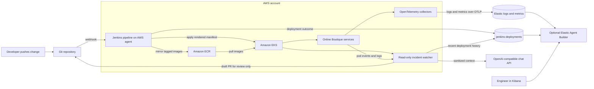

# AWS and Jenkins Setup

This guide deploys the Online Boutique demonstration and a read-only incident watcher to Amazon EKS. Jenkins mirrors the public demonstration images into Amazon ECR, builds and deploys the watcher, applies the rendered application manifest, waits for the Deployments to become ready, and records the deployment attempt and its outcome in Elasticsearch. Failed rollouts are indexed too, so the incident history can be correlated with the change that caused them.

The checked-out repository does not contain the microservice source code or Dockerfiles. The Jenkins pipeline therefore mirrors the public sample images listed in `release/image-sources.txt`; it does not build the services from source. Those upstream sample images currently include public Google Artifact Registry references, used only as the migration source; the deployed pods pull from ECR. To remove that last Google registry dependency, replace those source entries with images from a registry you control or add the application source and build definitions. The application manifest uses ECR image placeholders and must be rendered by the pipeline before applying it.

The incident watcher continuously watches pod status changes in the `online-boutique` namespace, reads the affected container's recent logs, and correlates them with Jenkins deployment records and an OpenAI-compatible chat API. For a sufficiently confident `OOMKilled` diagnosis, it can open a **draft GitHub pull request** proposing only a memory request/limit increase in the affected Deployment. It has Kubernetes read-only permissions and cannot modify or restart production pods. Other issue types are diagnosed and logged but do not currently produce a code-change PR.

## Architecture



## Prerequisites

Use an AWS account with permission to create VPC, EKS, ECR, and IAM resources. On the machine used for the commands below, install AWS CLI v2, Terraform 1.5 or later, Docker Desktop, kubectl, Helm, eksctl, Python 3, and Git. You also need an OpenAI-compatible chat-completions endpoint and a GitHub fine-grained token for the target repository.

Authenticate to AWS with IAM Identity Center or another short-lived credential method. Do not put AWS access keys, Elastic API keys, or passwords in this repository.

The local command examples in this guide use **Windows PowerShell**. Jenkins runs the checked-in pipeline on a Linux agent and executes its `sh` steps there. The Jenkins controller/agent installation and multibranch job creation are separate manual Jenkins administration tasks; this Terraform configuration does not install Jenkins or create its EC2 host.

Clone the repository if it is not already on your machine, then run the remaining local commands from its root directory:

```powershell
git clone https://github.com/Ayush-Singh986/AI-observability-main.git
Set-Location AI-observability-main
```

### Quick guide to the project files

Start with [README.md](./README.md) for the project overview and this setup guide to deploy it. These are the main files you will use:

| File | What it does |
| --- | --- |
| [Jenkinsfile](./Jenkinsfile) | Runs the build and deployment steps when Jenkins builds the `main` branch. |
| [Terraform main.tf](./.github/terraform/main.tf) | Creates the AWS network, EKS cluster, ECR repository, and Jenkins access role. |
| [Terraform variables.tf](./.github/terraform/variables.tf) | Sets the cluster, AWS region, node sizes, and allowed API IP addresses. |
| [Terraform outputs.tf](./.github/terraform/outputs.tf) | Prints useful values such as the cluster name and Jenkins instance profile. |
| [Terraform versions.tf](./.github/terraform/versions.tf) | Sets the required Terraform and AWS provider versions. |
| [release/kubernetes-manifests.yaml](./release/kubernetes-manifests.yaml) | Defines the sample store services that Jenkins deploys to Kubernetes. |
| [release/image-sources.txt](./release/image-sources.txt) | Lists the public images Jenkins copies into Amazon ECR. |
| [release/incident-agent.yaml](./release/incident-agent.yaml) | Defines the incident watcher and its non-secret settings. |
| [release/incident-agent-rbac.yaml](./release/incident-agent-rbac.yaml) | Gives the watcher permission to read pod status and logs, but not change pods. |
| [incident-agent/Dockerfile](./incident-agent/Dockerfile) | Packages the Python watcher into a container image. |
| [incident-agent/requirements.txt](./incident-agent/requirements.txt) | Lists Python packages needed by the watcher. |
| [scripts/mirror-images-to-ecr.py](./scripts/mirror-images-to-ecr.py) | Copies the sample images into ECR and creates a deployable manifest. |
| [scripts/publish-incident-agent.py](./scripts/publish-incident-agent.py) | Builds and uploads the watcher image to ECR. |
| [scripts/render-incident-agent.py](./scripts/render-incident-agent.py) | Adds the ECR image address to the watcher deployment file. |
| [scripts/incident-agent.py](./scripts/incident-agent.py) | Watches for pod problems, gathers evidence, and can open a draft fix PR. |
| [scripts/index-deployment.py](./scripts/index-deployment.py) | Records Jenkins deployment results in Elasticsearch. |
| [tests/test_incident_agent.py](./tests/test_incident_agent.py) | Checks the watcher’s incident handling and safety rules. |

Other files help explain or maintain the project: [.github/terraform/README.md](./.github/terraform/README.md) describes the AWS infrastructure, and [.github/workflows/README.md](./.github/workflows/README.md) explains the workflow folder. Deployment is run by the root [Jenkinsfile](./Jenkinsfile), not a GitHub Actions workflow. [.gitignore](./.gitignore) and [.dockerignore](./.dockerignore) keep generated or unnecessary files out of Git and container builds.

For AWS IAM Identity Center authentication, configure a profile once, log in, and confirm the identity before provisioning:

```powershell
aws configure sso --profile boutique-admin
aws sso login --profile boutique-admin
$env:AWS_PROFILE = "boutique-admin"
aws sts get-caller-identity
```

Keep the same PowerShell window open so the profile and Terraform output variables remain available for later commands.

Before provisioning AWS, validate the watcher locally from the repository root:

```powershell
python -m venv .venv
.\.venv\Scripts\Activate.ps1
python -m pip install -r incident-agent\requirements.txt
python -m unittest discover -s tests -v
```

If PowerShell blocks virtual-environment activation, use `python -m pip install --user -r incident-agent\requirements.txt` and run the tests without activating the environment.

## 1. Provision AWS infrastructure

Terraform creates a VPC with public and private subnets, an EKS cluster with managed worker nodes, an ECR repository, and an EC2 instance profile and IAM role for Jenkins agents. The role is allowed to push images to the project ECR repository and to edit resources only in the `online-boutique` Kubernetes namespace.

The EKS API endpoint is public and private. The Terraform requires an explicit public endpoint CIDR; replace `YOUR_PUBLIC_IP/32` below with the trusted administrator's public IP in CIDR notation. Do not use `0.0.0.0/0`. For production, host Jenkins agents in the VPC so they can use the private endpoint, and keep the public endpoint restricted to administrator IPs.

```powershell
$AwsRegion = "us-east-1"
$ClusterName = "blame-the-deploy"
$TrustedPublicIp = Read-Host "Trusted administrator public IPv4 address (without /32)"
Push-Location .github\terraform
terraform init
terraform validate
terraform plan -out=tfplan `
  -var="aws_region=$AwsRegion" `
  -var="cluster_name=$ClusterName" `
  -var="cluster_endpoint_public_access_cidrs=[`"$TrustedPublicIp/32`"]"
terraform apply tfplan
$ClusterName = terraform output -raw cluster_name
$AwsRegion = terraform output -raw aws_region
$JenkinsInstanceProfile = terraform output -raw jenkins_instance_profile_name
$PrivateSubnetIds = terraform output -json private_subnet_ids | ConvertFrom-Json
Pop-Location
```

The Terraform state uses the local backend. Keep `terraform.tfstate` private and do not commit it. For a shared team deployment, configure an encrypted, versioned S3 backend and a DynamoDB lock table before applying infrastructure.

The commands above retain the cluster name, region, Jenkins instance profile, and private subnet IDs in the current PowerShell session. Attach the instance profile to the Jenkins EC2 agent. Run the agent in a private subnet to use the EKS private endpoint; if the agent uses the public endpoint instead, include its trusted public egress IP CIDR in `cluster_endpoint_public_access_cidrs` during Terraform provisioning. If you already have an EC2 agent without a profile, set its instance ID and run:

```powershell
$JenkinsInstanceId = Read-Host "Jenkins EC2 agent instance ID"
aws ec2 associate-iam-instance-profile `
  --instance-id $JenkinsInstanceId `
  --iam-instance-profile Name=$JenkinsInstanceProfile `
  --region $AwsRegion
```

If the instance already has a profile, replace it with `aws ec2 replace-iam-instance-profile-association` using the association ID from `aws ec2 describe-iam-instance-profile-associations`; do not attempt to associate a second profile. Place the agent in a subnet that can reach the EKS API and public image registries; the private subnets created by Terraform use a NAT gateway for outbound access.

The EKS edit access policy is scoped to the `online-boutique` namespace. Create that namespace once using the AWS administrator credentials:

```powershell
aws eks update-kubeconfig --region $AwsRegion --name $ClusterName
kubectl get nodes
kubectl create namespace online-boutique --dry-run=client -o yaml | kubectl apply -f -
```

The cluster creator receives administrative access from the Terraform module. Use that administrator context only for initial cluster setup and platform components.

Bootstrap the incident watcher ServiceAccount and read-only RoleBinding with the cluster administrator. This is intentionally separate from the Jenkins deployment identity:

```powershell
kubectl apply -f release\incident-agent-rbac.yaml
```

## 2. Configure Jenkins

Install/manage a Jenkins controller separately, then create a **Multibranch Pipeline** job pointing at this Git repository. Configure a Linux agent with the `aws-jenkins` label and install AWS CLI v2, Docker, kubectl, and Python 3 on it. The agent must be able to run Docker commands and reach EKS, ECR, and the public source image registries. Attach the Terraform-created instance profile to the EC2 agent; the instance role provides AWS authentication, so do not add static AWS keys to Jenkins.

Configure GitHub branch discovery and (optionally) a webhook to trigger scans. The Jenkinsfile deploys only the `main` branch, with `AWS_REGION` and `EKS_CLUSTER_NAME` parameters. Protect `main` with required human review and status checks; do not bypass repository branch protection to run a demo.

Create these two Jenkins **Secret text** credentials:

| Credential ID | Value |
| --- | --- |
| `elastic-endpoint` | Elasticsearch endpoint URL, for example `https://your-deployment.example.com:443` |
| `elastic-api-key` | Jenkins-only Elasticsearch API key with permission to create documents in `jenkins-deployments` |

The incident watcher uses a different read-only key stored in Kubernetes. Do not reuse the watcher key for Jenkins writes.

The image-mirroring stage reads the source references in `release/image-sources.txt`, pushes them to the `online-boutique` ECR repository, and substitutes the real ECR registry hostname into a generated manifest under `build/`. It does not modify the checked-in template. A source image that is unavailable or cannot be pulled causes the pipeline to fail rather than silently deploying a mixed set of registries.

Before running Jenkins for the first time, create a Kubernetes Secret for the watcher. The fine-grained GitHub token should be limited to this repository with **Contents: read and write**, **Pull requests: read and write**, and **Metadata: read** permissions. The watcher creates draft PRs only; it does not merge them.

Create the secret from a temporary file in the Windows user temp directory. Secret values are prompted without echoing and are not typed into commands; the temporary file is removed after `kubectl` applies it.

```powershell
function Read-SecretValue($Prompt) {
    $SecureValue = Read-Host -Prompt $Prompt -AsSecureString
    $Bstr = [Runtime.InteropServices.Marshal]::SecureStringToBSTR($SecureValue)
    try {
        [Runtime.InteropServices.Marshal]::PtrToStringBSTR($Bstr)
    } finally {
        [Runtime.InteropServices.Marshal]::ZeroFreeBSTR($Bstr)
    }
}

$SecretFile = Join-Path $env:TEMP "incident-agent.env"
$WatcherEsEndpoint = Read-Host "Elasticsearch endpoint URL"
$WatcherEsApiKey = Read-SecretValue "Read-only Elasticsearch API key for jenkins-deployments"
$AiApiKey = Read-SecretValue "OpenAI-compatible API key"
$GithubToken = Read-SecretValue "Fine-grained GitHub token"
@"
ES_ENDPOINT=$WatcherEsEndpoint
ES_API_KEY=$WatcherEsApiKey
AI_API_KEY=$AiApiKey
GITHUB_TOKEN=$GithubToken
"@ | Set-Content -Path $SecretFile -Encoding ascii
try {
    kubectl create secret generic incident-agent-secrets `
      --namespace online-boutique `
      --from-env-file="$SecretFile" `
      --dry-run=client -o yaml | kubectl apply -f -
    if ($LASTEXITCODE -ne 0) { throw "Could not apply incident-agent-secrets." }
} finally {
    Remove-Item -LiteralPath $SecretFile -Force -ErrorAction SilentlyContinue
    Remove-Variable WatcherEsEndpoint, WatcherEsApiKey, AiApiKey, GithubToken -ErrorAction SilentlyContinue
}
```

Run the secret setup again to rotate credentials; `kubectl apply` updates an existing Secret.

Use an Elasticsearch API key that can only search `jenkins-deployments`. The OpenAI-compatible endpoint and model are set in `release/incident-agent.yaml` as `AI_BASE_URL` and `AI_MODEL`; change these values to match your provider before deploying. The watcher sends redacted, bounded log excerpts plus deployment metadata to that provider. Review your provider's data-handling terms before sending production logs outside AWS, and do not enable this integration if your logs contain data that must not leave your environment.

The Jenkins deployment identity can update resources in the application namespace, but the incident watcher's Kubernetes ServiceAccount is separately bound to a Role that only reads and watches pods and reads pod logs. Do not grant the watcher write verbs or cluster-admin permissions.

## 3. Configure the public frontend

The `frontend-external` Kubernetes Service is annotated for an internet-facing Network Load Balancer using IP targets. Terraform enables the cluster OIDC provider for IAM Roles for Service Accounts. Install the AWS Load Balancer Controller before deploying the application; the Service annotations alone do not install it. The following first-install commands follow the [AWS Helm installation guide](https://docs.aws.amazon.com/eks/latest/userguide/lbc-helm.html) and use controller IAM policy v2.14.1 and chart 1.14.0. Check the AWS guide for updates and version compatibility before using this in production.

Retrieve the VPC ID for the EKS private subnets:

```powershell
Push-Location .github\terraform
$PrivateSubnetIds = terraform output -json private_subnet_ids | ConvertFrom-Json
Pop-Location
$VpcId = aws ec2 describe-subnets `
  --subnet-ids $PrivateSubnetIds[0] `
  --query "Subnets[0].VpcId" `
  --output text `
  --region $AwsRegion
$AwsAccountId = aws sts get-caller-identity --query Account --output text
```

Download the controller's IAM policy and create it once in the AWS account. If the named policy already exists, skip `create-policy` and use its existing ARN:

```powershell
$LbcPolicyFile = Join-Path $env:TEMP "aws-lbc-iam-policy.json"
Invoke-WebRequest `
  -Uri "https://raw.githubusercontent.com/kubernetes-sigs/aws-load-balancer-controller/v2.14.1/docs/install/iam_policy.json" `
  -OutFile $LbcPolicyFile
aws iam create-policy `
  --policy-name AWSLoadBalancerControllerIAMPolicy `
  --policy-document "file://$LbcPolicyFile"
Remove-Item -LiteralPath $LbcPolicyFile -Force
$LbcPolicyArn = "arn:aws:iam::${AwsAccountId}:policy/AWSLoadBalancerControllerIAMPolicy"
eksctl create iamserviceaccount `
  --cluster $ClusterName `
  --namespace kube-system `
  --name aws-load-balancer-controller `
  --attach-policy-arn $LbcPolicyArn `
  --override-existing-serviceaccounts `
  --region $AwsRegion `
  --approve
helm repo add eks https://aws.github.io/eks-charts
helm repo update eks
helm upgrade --install aws-load-balancer-controller eks/aws-load-balancer-controller `
  --namespace kube-system `
  --set "clusterName=$ClusterName" `
  --set serviceAccount.create=false `
  --set serviceAccount.name=aws-load-balancer-controller `
  --set "region=$AwsRegion" `
  --set "vpcId=$VpcId" `
  --version 1.14.0
kubectl rollout status deployment/aws-load-balancer-controller `
  --namespace kube-system `
  --timeout=5m
```

On a later controller chart upgrade, follow AWS guidance for updating its CRDs; a Helm upgrade does not install changed CRDs automatically.

Once installed, the controller provisions the Network Load Balancer when Jenkins applies the manifest. Retrieve its address after deployment:

```powershell
kubectl get service frontend-external --namespace online-boutique
```

For a local demonstration, the frontend can also be accessed without a public load balancer:

```powershell
kubectl port-forward --namespace online-boutique service/frontend 8080:80
```

Then open `http://localhost:8080`.

## 4. Install OpenTelemetry and connect Elasticsearch

The OpenTelemetry Kubernetes stack is cloud-agnostic and can run on EKS. Create a namespace and Kubernetes secret containing the Elastic OTLP endpoint and API key. The API key is prompted without echoing and is not typed into a command:

```powershell
function Read-SecretValue($Prompt) {
    $SecureValue = Read-Host -Prompt $Prompt -AsSecureString
    $Bstr = [Runtime.InteropServices.Marshal]::SecureStringToBSTR($SecureValue)
    try {
        [Runtime.InteropServices.Marshal]::PtrToStringBSTR($Bstr)
    } finally {
        [Runtime.InteropServices.Marshal]::ZeroFreeBSTR($Bstr)
    }
}

$OtelNamespace = "opentelemetry-operator-system"
$OtelSecretFile = Join-Path $env:TEMP "elastic-secret-otel.env"
$OtelEndpoint = Read-Host "Elastic OTLP ingest endpoint"
$OtelApiKey = Read-SecretValue "Elastic API key for OTLP ingestion"
@"
elastic_otlp_endpoint=$OtelEndpoint
elastic_api_key=$OtelApiKey
"@ | Set-Content -Path $OtelSecretFile -Encoding ascii
kubectl create namespace $OtelNamespace --dry-run=client -o yaml | kubectl apply -f -
try {
    kubectl create secret generic elastic-secret-otel `
      --namespace $OtelNamespace `
      --from-env-file="$OtelSecretFile" `
      --dry-run=client -o yaml | kubectl apply -f -
    if ($LASTEXITCODE -ne 0) { throw "Could not apply elastic-secret-otel." }
} finally {
    Remove-Item -LiteralPath $OtelSecretFile -Force -ErrorAction SilentlyContinue
    Remove-Variable OtelEndpoint, OtelApiKey -ErrorAction SilentlyContinue
}
helm repo add open-telemetry https://open-telemetry.github.io/opentelemetry-helm-charts --force-update
$OtelGatewayValuesFile = Join-Path $env:TEMP "otel-gateway-values.yaml"
@'
collectors:
  gateway:
    enabled: true
    fullnameOverride: opentelemetry-kube-stack-gateway
    mode: deployment
    env:
      - name: ELASTIC_OTLP_ENDPOINT
        valueFrom:
          secretKeyRef:
            name: elastic-secret-otel
            key: elastic_otlp_endpoint
      - name: ELASTIC_API_KEY
        valueFrom:
          secretKeyRef:
            name: elastic-secret-otel
            key: elastic_api_key
    config:
      receivers:
        otlp:
          protocols:
            grpc: {}
            http: {}
      exporters:
        otlphttp/elastic:
          endpoint: ${env:ELASTIC_OTLP_ENDPOINT}
          headers:
            Authorization: "ApiKey ${env:ELASTIC_API_KEY}"
      service:
        pipelines:
          logs:
            receivers: [otlp]
            exporters: [otlphttp/elastic]
          metrics:
            receivers: [otlp]
            exporters: [otlphttp/elastic]
          traces:
            receivers: [otlp]
            exporters: [otlphttp/elastic]
'@ | Set-Content -Path $OtelGatewayValuesFile -Encoding ascii
try {
    helm upgrade --install opentelemetry-kube-stack open-telemetry/opentelemetry-kube-stack `
      --namespace $OtelNamespace `
      --values "https://raw.githubusercontent.com/elastic/elastic-agent/refs/tags/v9.3.3/deploy/helm/edot-collector/kube-stack/managed_otlp/values.yaml" `
      --values $OtelGatewayValuesFile `
      --version 0.12.4
    if ($LASTEXITCODE -ne 0) { throw "Could not install the OpenTelemetry stack." }
} finally {
    Remove-Item -LiteralPath $OtelGatewayValuesFile -Force -ErrorAction SilentlyContinue
}
kubectl wait --for=condition=Ready pods --all --namespace $OtelNamespace --timeout=10m
kubectl get pods --namespace $OtelNamespace
```

Confirm the collector pods are ready and verify in Elasticsearch that the expected Kubernetes logs and metadata arrive. A collector installation alone does not guarantee that every OOM event is available to the agent; validate the actual event fields before relying on an Elasticsearch query for them.

## 5. Create the deployment-history index

Jenkins posts an event after a deployment attempt finishes, including when the rollout fails. Create the index with mappings suitable for filtering on service, commit, time, and outcome. Use an Elasticsearch API key with permission to create the index and write deployment documents; the Jenkins credential needs only the document-write privilege on this index.

```powershell
function Read-SecretValue($Prompt) {
    $SecureValue = Read-Host -Prompt $Prompt -AsSecureString
    $Bstr = [Runtime.InteropServices.Marshal]::SecureStringToBSTR($SecureValue)
    try {
        [Runtime.InteropServices.Marshal]::PtrToStringBSTR($Bstr)
    } finally {
        [Runtime.InteropServices.Marshal]::ZeroFreeBSTR($Bstr)
    }
}

$EsEndpoint = (Read-Host "Elasticsearch endpoint URL").TrimEnd("/")
$EsApiKey = Read-SecretValue "Elasticsearch API key for creating the index and writing deployment events"
$EsHeaders = @{
    Authorization = "ApiKey $EsApiKey"
    "Content-Type" = "application/json"
}
$IndexBody = @{
    mappings = @{
        properties = @{
            timestamp  = @{ type = "date" }
            commit_sha = @{ type = "keyword" }
            author     = @{ type = "keyword" }
            service    = @{ type = "keyword" }
            image_tag  = @{ type = "keyword" }
            change     = @{ type = "text" }
            outcome    = @{ type = "keyword" }
            cluster    = @{ type = "keyword" }
            build_url  = @{ type = "keyword" }
        }
    }
} | ConvertTo-Json -Depth 5
Invoke-RestMethod -Method Put `
  -Uri "$EsEndpoint/jenkins-deployments" `
  -Headers $EsHeaders `
  -Body $IndexBody
```

Use a temporary bootstrap key for index creation, then store a separate, least-privilege document-write key in Jenkins. Jenkins deployment history is separate from the `logs-*` telemetry data streams.

## 6. Run and verify the deployment

Push a change to the `main` branch or run the Jenkins multibranch scan. Jenkins validates its tools and input files, authenticates to ECR using its instance role, mirrors the application images, builds the incident watcher image, applies its read-only RBAC and Deployment, applies the application manifest, waits for each Deployment rollout, and writes the deployment outcome to Elasticsearch.

Check application health from PowerShell:

```powershell
kubectl get deployments,pods,services --namespace online-boutique
kubectl get service frontend-external --namespace online-boutique
kubectl logs deployment/incident-agent --namespace online-boutique --follow
```

Check Elasticsearch for the latest deployment events using a separate read-only API key:

```powershell
function Read-SecretValue($Prompt) {
    $SecureValue = Read-Host -Prompt $Prompt -AsSecureString
    $Bstr = [Runtime.InteropServices.Marshal]::SecureStringToBSTR($SecureValue)
    try {
        [Runtime.InteropServices.Marshal]::PtrToStringBSTR($Bstr)
    } finally {
        [Runtime.InteropServices.Marshal]::ZeroFreeBSTR($Bstr)
    }
}

$ReadEsApiKey = Read-SecretValue "Read-only Elasticsearch API key for jenkins-deployments"
$ReadEsHeaders = @{
    Authorization = "ApiKey $ReadEsApiKey"
    "Content-Type" = "application/json"
}
$SearchBody = @{
    query = @{ match_all = @{} }
    sort = @(@{ timestamp = "desc" })
    size = 5
} | ConvertTo-Json -Depth 5
Invoke-RestMethod -Method Post `
  -Uri "$EsEndpoint/jenkins-deployments/_search?pretty" `
  -Headers $ReadEsHeaders `
  -Body $SearchBody
Remove-Variable ReadEsApiKey, ReadEsHeaders -ErrorAction SilentlyContinue
```

In Kibana, configure Agent Builder query tools to retrieve recent failure telemetry from `logs-*` and recent releases from `jenkins-deployments`. The agent can compare service and timestamp fields, then explain which deployment is a likely cause. It should cite the commit and telemetry it used; it cannot prove causation if the required event was not collected.

The incident watcher also runs its own narrow diagnosis flow. It watches live pod state changes, examines the previous container logs when available, queries recent deployment history, and asks the configured chat model for a structured diagnosis. It can open a draft PR only when the pod reports `OOMKilled`, the model confidence is at least `0.70`, and the suggested memory values pass strict limits. The PR changes only the affected container's memory request and limit, never the running cluster. Check `kubectl logs deployment/incident-agent -n online-boutique` for diagnoses and draft PR links. `ImagePullBackOff`, configuration errors, and other failures are reported in logs but require a human-created fix.

To demonstrate an incident, make a temporary change to the payment service’s memory request and limit in `release/kubernetes-manifests.yaml`, push it to `main`, and observe the pod’s restart state and collected telemetry. Revert the change after demonstrating diagnosis. Do not perform the failure exercise in a shared or production cluster.

## Project efficiency, achievements, and results

- **Automated delivery:** Jenkins validates the deployment inputs, mirrors application images to ECR, deploys to EKS, waits for rollouts, and records both successful and failed deployment attempts in Elasticsearch.
- **Incident investigation:** The watcher correlates pod status, recent logs, and deployment history. For a sufficiently confident `OOMKilled` diagnosis, it can propose a bounded memory change in a draft pull request for human review; it cannot modify running workloads.
- **Test result:** The incident-watcher unit suite passed **9 of 9 tests (100%)** in the local verification run. This measures the checked-in unit tests only, not production reliability or overall project completion.
- **Efficiency measurement:** No before-and-after incident-resolution times, deployment durations, cost measurements, or production results are recorded in this repository. Therefore, a time-savings or overall-efficiency percentage cannot be stated reliably. Measure investigation time over comparable incidents before and after deployment to calculate that percentage.

## 7. Remove the demo infrastructure

The cluster, EC2 worker nodes, NAT gateway, and load balancer incur AWS charges. Destroying this Terraform configuration also deletes the ECR repository and its mirrored images. When the demo is no longer needed, first remove the Kubernetes workloads and load balancer, then destroy the Terraform-managed resources:

```powershell
kubectl delete namespace online-boutique
if ($LASTEXITCODE -ne 0) { throw "Could not delete online-boutique." }
Push-Location .github\terraform
terraform destroy -var="aws_region=$AwsRegion" `
  -var="cluster_name=$ClusterName" `
  -var="cluster_endpoint_public_access_cidrs=[`"$TrustedPublicIp/32`"]"
Pop-Location
```

Keep or delete the Elasticsearch deployment separately according to its retention and billing settings. Confirm the ECR images and any manually installed Jenkins or AWS Load Balancer Controller resources are no longer needed before removing them.
