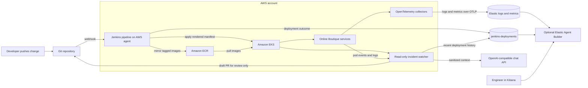

# AWS and Jenkins Setup

This guide deploys the Online Boutique demonstration and a read-only incident watcher to Amazon EKS. Jenkins mirrors the public demonstration images into Amazon ECR, builds and deploys the watcher, applies the rendered application manifest, waits for the Deployments to become ready, and records the deployment attempt and its outcome in Elasticsearch. Failed rollouts are indexed too, so the incident history can be correlated with the change that caused them.

The checked-out repository does not contain the microservice source code or Dockerfiles. The Jenkins pipeline therefore mirrors the public sample images listed in `release/image-sources.txt`; it does not build the services from source. Those upstream sample images currently include public Google Artifact Registry references, used only as the migration source; the deployed pods pull from ECR. To remove that last Google registry dependency, replace those source entries with images from a registry you control or add the application source and build definitions. The application manifest uses ECR image placeholders and must be rendered by the pipeline before applying it.

The incident watcher continuously watches pod status changes in the `online-boutique` namespace, reads the affected container's recent logs, and correlates them with Jenkins deployment records and an OpenAI-compatible chat API. For a sufficiently confident `OOMKilled` diagnosis, it can open a **draft GitHub pull request** proposing only a memory request/limit increase in the affected Deployment. It has Kubernetes read-only permissions and cannot modify or restart production pods. Other issue types are diagnosed and logged but do not currently produce a code-change PR.

## Architecture



## Prerequisites

Use an AWS account with permission to create VPC, EKS, ECR, and IAM resources. Install AWS CLI v2, Terraform 1.5 or later, Docker, kubectl, Helm, Python 3, Git, and a Jenkins controller with a Linux agent labelled `aws-jenkins`. The Jenkins agent must have AWS CLI, Docker, kubectl, and Python 3 installed. You also need an OpenAI-compatible chat-completions endpoint and a GitHub fine-grained token for the target repository.

Authenticate to AWS with IAM Identity Center or another short-lived credential method. Do not put AWS access keys, Elastic API keys, or passwords in this repository.

## 1. Provision AWS infrastructure

Terraform creates a VPC with public and private subnets, an EKS cluster with managed worker nodes, an ECR repository, and an EC2 instance profile and IAM role for Jenkins agents. The role is allowed to push images to the project ECR repository and to edit resources only in the `online-boutique` Kubernetes namespace.

The EKS API endpoint is public and private. The Terraform requires an explicit public endpoint CIDR; replace `YOUR_PUBLIC_IP/32` below with the trusted administrator IP range. For production, host Jenkins agents in the VPC so they can use the private endpoint, and keep the public endpoint restricted to administrator IPs.

```bash
cd .github/terraform
terraform init
terraform plan \
  -out=tfplan \
  -var='aws_region=us-east-1' \
  -var='cluster_endpoint_public_access_cidrs=["YOUR_PUBLIC_IP/32"]'
terraform apply tfplan
```

The Terraform state uses the local backend. Keep `terraform.tfstate` private and do not commit it. For a shared team deployment, configure an encrypted, versioned S3 backend and a DynamoDB lock table before applying infrastructure.

Record the output values for `cluster_name`, `aws_region`, `ecr_registry`, and `jenkins_instance_profile_name`. Attach the instance profile to the Jenkins EC2 agent. Place the agent in a subnet that can reach the EKS API and public image registries; the private subnets created by Terraform use a NAT gateway for outbound access.

The EKS edit access policy is scoped to the `online-boutique` namespace. Create that namespace once using the AWS administrator credentials:

```bash
aws eks update-kubeconfig --region us-east-1 --name blame-the-deploy
kubectl create namespace online-boutique
```

The cluster creator receives administrative access from the Terraform module. Use that administrator context only for initial cluster setup and platform components.

Bootstrap the incident watcher ServiceAccount and read-only RoleBinding with the cluster administrator. This is intentionally separate from the Jenkins deployment identity:

```bash
kubectl apply -f release/incident-agent-rbac.yaml
```

## 2. Configure Jenkins

Create a Jenkins multibranch pipeline pointing at this repository and configure its Linux agent with the `aws-jenkins` label. The agent instance profile provides AWS authentication; no static AWS keys are required. The Jenkins agent needs permission to run Docker commands and should have network access to EKS, ECR, and the public source image registries.

Add two Jenkins **Secret text** credentials:

| Credential ID | Value |
| --- | --- |
| `elastic-endpoint` | Elasticsearch endpoint URL, for example `https://your-deployment.example.com:443` |
| `elastic-api-key` | Elasticsearch API key with permission to create documents in `jenkins-deployments` |

The multibranch pipeline deploys only the `main` branch. Its default parameters are `AWS_REGION=us-east-1` and `EKS_CLUSTER_NAME=blame-the-deploy`; change the build parameters if Terraform used different values.

The image-mirroring stage reads the source references in `release/image-sources.txt`, pushes them to the `online-boutique` ECR repository, and substitutes the real ECR registry hostname into a generated manifest under `build/`. It does not modify the checked-in template. A source image that is unavailable or cannot be pulled causes the pipeline to fail rather than silently deploying a mixed set of registries.

Before running Jenkins for the first time, create a Kubernetes Secret for the watcher. The fine-grained GitHub token should be limited to this repository with **Contents: read and write**, **Pull requests: read and write**, and **Metadata: read** permissions. Protect `main` with required human review and status checks. The watcher creates draft PRs only; it does not merge them.

Create a temporary local environment file without putting values directly in shell history:

```bash
umask 077
cat > incident-agent.env <<'EOF'
ES_ENDPOINT=https://<YOUR-ELASTICSEARCH-ENDPOINT>
ES_API_KEY=<INDEX-READ-ONLY-ELASTIC-API-KEY>
AI_API_KEY=<OPENAI-COMPATIBLE-API-KEY>
GITHUB_TOKEN=<FINE-GRAINED-REPOSITORY-TOKEN>
EOF

kubectl create secret generic incident-agent-secrets \
  --namespace online-boutique \
  --from-env-file=incident-agent.env
rm incident-agent.env
```

Use an Elasticsearch API key that can only search `jenkins-deployments`. The OpenAI-compatible endpoint and model are set in `release/incident-agent.yaml` as `AI_BASE_URL` and `AI_MODEL`; change these values to match your provider before deploying. The watcher sends redacted, bounded log excerpts plus deployment metadata to that provider. Review your provider's data-handling terms before sending production logs outside AWS, and do not enable this integration if your logs contain data that must not leave your environment.

The Jenkins deployment identity can update resources in the application namespace, but the incident watcher's Kubernetes ServiceAccount is separately bound to a Role that only reads and watches pods and reads pod logs. Do not grant the watcher write verbs or cluster-admin permissions.

## 3. Configure the public frontend

The `frontend-external` Kubernetes Service is annotated for an internet-facing Network Load Balancer using IP targets. Terraform enables the cluster OIDC provider for IAM Roles for Service Accounts. Install the [AWS Load Balancer Controller](https://docs.aws.amazon.com/eks/latest/userguide/lbc-helm.html) and associate its service account with a least-privilege IAM role before deploying the application. Follow the AWS controller installation guide for the matching EKS version and use the `blame-the-deploy` cluster name. The controller is an AWS prerequisite; the Service annotations alone do not install it.

Once installed, the controller provisions the Network Load Balancer when Jenkins applies the manifest. Retrieve its address after deployment:

```bash
kubectl get service frontend-external -n online-boutique
```

For a local demonstration, the frontend can also be accessed without a public load balancer:

```bash
kubectl port-forward -n online-boutique service/frontend 8080:80
```

Then open `http://localhost:8080`.

## 4. Install OpenTelemetry and connect Elasticsearch

The OpenTelemetry Kubernetes stack is cloud-agnostic and can run on EKS. Create a namespace and Kubernetes secret containing the Elastic OTLP endpoint and API key. Do not commit the secret or enter its values into shell history on a shared machine.

```bash
kubectl create namespace opentelemetry-operator-system
kubectl create secret generic elastic-secret-otel \
  --namespace opentelemetry-operator-system \
  --from-literal=elastic_otlp_endpoint='<YOUR-OTLP-INGEST-ENDPOINT>' \
  --from-literal=elastic_api_key='<YOUR-ELASTIC-API-KEY>'

helm repo add open-telemetry \
  https://open-telemetry.github.io/opentelemetry-helm-charts \
  --force-update
helm upgrade --install opentelemetry-kube-stack \
  open-telemetry/opentelemetry-kube-stack \
  --namespace opentelemetry-operator-system \
  --values 'https://raw.githubusercontent.com/elastic/elastic-agent/refs/tags/v9.3.3/deploy/helm/edot-collector/kube-stack/managed_otlp/values.yaml' \
  --version 0.12.4
```

Confirm the collector pods are ready and verify in Elasticsearch that the expected Kubernetes logs and metadata arrive. A collector installation alone does not guarantee that every OOM event is available to the agent; validate the actual event fields before relying on an Elasticsearch query for them.

## 5. Create the deployment-history index

Jenkins posts an event after a deployment attempt finishes, including when the rollout fails. Create the index with mappings suitable for filtering on service, commit, time, and outcome:

```bash
curl --fail-with-body -X PUT '<YOUR-ES-ENDPOINT>/jenkins-deployments' \
  -H 'Authorization: ApiKey <YOUR-ELASTIC-API-KEY>' \
  -H 'Content-Type: application/json' \
  -d '{
    "mappings": {
      "properties": {
        "timestamp":  { "type": "date" },
        "commit_sha": { "type": "keyword" },
        "author":     { "type": "keyword" },
        "service":    { "type": "keyword" },
        "image_tag":  { "type": "keyword" },
        "change":     { "type": "text" },
        "outcome":    { "type": "keyword" },
        "cluster":    { "type": "keyword" },
        "build_url":  { "type": "keyword" }
      }
    }
  }'
```

Use an API key with only the required index privileges. Jenkins deployment history is separate from the `logs-*` telemetry data streams.

## 6. Run and verify the deployment

Push a change to the `main` branch or run the Jenkins multibranch scan. Jenkins validates its tools and input files, authenticates to ECR using its instance role, mirrors the application images, builds the incident watcher image, applies its read-only RBAC and Deployment, applies the application manifest, waits for each Deployment rollout, and writes the deployment outcome to Elasticsearch.

Check application health:

```bash
kubectl get deployments,pods,services -n online-boutique
kubectl get service frontend-external -n online-boutique
kubectl logs deployment/incident-agent -n online-boutique --follow
```

Check Elasticsearch for the new deployment event:

```bash
curl --fail-with-body '<YOUR-ES-ENDPOINT>/jenkins-deployments/_search?pretty' \
  -H 'Authorization: ApiKey <YOUR-ELASTIC-API-KEY>' \
  -H 'Content-Type: application/json' \
  -d '{"query":{"match_all":{}},"sort":[{"timestamp":"desc"}],"size":5}'
```

In Kibana, configure Agent Builder query tools to retrieve recent failure telemetry from `logs-*` and recent releases from `jenkins-deployments`. The agent can compare service and timestamp fields, then explain which deployment is a likely cause. It should cite the commit and telemetry it used; it cannot prove causation if the required event was not collected.

The incident watcher also runs its own narrow diagnosis flow. It watches live pod state changes, examines the previous container logs when available, queries recent deployment history, and asks the configured chat model for a structured diagnosis. It can open a draft PR only when the pod reports `OOMKilled`, the model confidence is at least `0.70`, and the suggested memory values pass strict limits. The PR changes only the affected container's memory request and limit, never the running cluster. Check `kubectl logs deployment/incident-agent -n online-boutique` for diagnoses and draft PR links. `ImagePullBackOff`, configuration errors, and other failures are reported in logs but require a human-created fix.

To demonstrate an incident, make a temporary change to the payment service’s memory request and limit in `release/kubernetes-manifests.yaml`, push it to `main`, and observe the pod’s restart state and collected telemetry. Revert the change after demonstrating diagnosis. Do not perform the failure exercise in a shared or production cluster.

## Project efficiency, achievements, and results

- **Automated delivery:** Jenkins validates the deployment inputs, mirrors application images to ECR, deploys to EKS, waits for rollouts, and records both successful and failed deployment attempts in Elasticsearch.
- **Incident investigation:** The watcher correlates pod status, recent logs, and deployment history. For a sufficiently confident `OOMKilled` diagnosis, it can propose a bounded memory change in a draft pull request for human review; it cannot modify running workloads.
- **Test result:** The incident-watcher unit suite passed **9 of 9 tests (100%)** in the local verification run. This measures the checked-in unit tests only, not production reliability or overall project completion.
- **Efficiency measurement:** No before-and-after incident-resolution times, deployment durations, cost measurements, or production results are recorded in this repository. Therefore, a time-savings or overall-efficiency percentage cannot be stated reliably. Measure investigation time over comparable incidents before and after deployment to calculate that percentage.

## 7. Remove the demo infrastructure

The cluster, EC2 worker nodes, NAT gateway, and load balancer incur AWS charges. Destroying this Terraform configuration also deletes the ECR repository and its mirrored images. When the demo is no longer needed, first remove the Kubernetes workloads and load balancer, then destroy the Terraform-managed resources:

```bash
kubectl delete namespace online-boutique
cd .github/terraform
terraform destroy
```

Keep or delete the Elasticsearch deployment separately according to its retention and billing settings. Confirm the ECR images and any manually installed Jenkins or AWS Load Balancer Controller resources are no longer needed before removing them.
